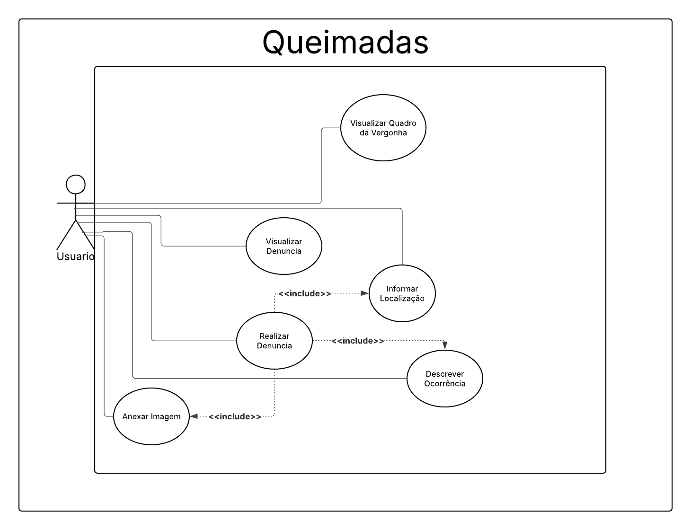

# Especificação do Projeto

## Introdução

O projeto **Disque Denúncia Queimadas e Irregularidades** foi desenvolvido com o objetivo de auxiliar no monitoramento ambiental do município de Betim – MG, permitindo o registro e análise de focos de queimadas e irregularidades ambientais através de uma plataforma web interativa.

A solução foi criada para substituir processos manuais baseados em planilhas e relatórios estáticos, oferecendo uma plataforma dinâmica composta por mapas interativos, dashboard analítico e registro de denúncias em tempo real.

Para elaboração desta especificação foram utilizadas técnicas de modelagem de requisitos, histórias de usuários, definição de personas, requisitos funcionais e não funcionais, além de metodologias ágeis baseadas em **Extreme Programming (XP)**.

---

# Modelo de Negócio (Business Model Canvas)

## Parceiros-chave

- Prefeitura de Betim;
- Órgãos ambientais;
- Corpo de Bombeiros;
- IBGE (dados geográficos);
- OpenStreetMap;
- Equipe de desenvolvimento.

---

## Atividades-chave

- Monitoramento ambiental;
- Registro de denúncias;
- Atualização do mapa geográfico;
- Geração de gráficos analíticos;
- Manutenção da plataforma.

---

## Proposta de Valor

O sistema oferece uma plataforma interativa para monitoramento ambiental em tempo real, permitindo identificar rapidamente regiões com maior incidência de queimadas e irregularidades ambientais, auxiliando órgãos responsáveis na tomada de decisão.

---

## Relacionamento com Clientes

- Plataforma web intuitiva;
- Atualização dinâmica das informações;
- Navegação simplificada;
- Acompanhamento visual das ocorrências.

---

## Segmentos de Clientes

- Órgãos ambientais;
- Gestores públicos;
- Fiscalização ambiental;
- População local;
- Equipes de brigada.

---

## Recursos-chave

- Plataforma web;
- Banco de dados SQLite;
- APIs em PHP;
- Dados geográficos GeoJSON;
- Servidor web;
- Bibliotecas JavaScript.

---

## Canais de Distribuição

- Plataforma web hospedada online;
- GitHub;
- Navegadores web.

---

## Estrutura de Custos

- Hospedagem;
- Desenvolvimento do sistema;
- Manutenção da plataforma;
- Banco de dados;
- Infraestrutura de servidor.

---

## Fontes de Receita

O projeto possui caráter acadêmico e social, não apresentando fins lucrativos ou monetização comercial.

---

=# Personas

## Persona 1 — Gestor Ambiental

<table>
<tr>
<td width="220" align="center">

 
<strong>Foto da Persona</strong>

</td>

<td>

### Carlos Henrique

| Informação | Detalhes |
|------------|----------|
| Idade | 42 anos |
| Profissão | Coordenador Ambiental |
| Perfil | Responsável pelo monitoramento ambiental e apoio à tomada de decisões estratégicas |

#### Objetivo

Monitorar focos de queimadas em tempo real e auxiliar no direcionamento das equipes de fiscalização.

#### Necessidades

- Visualização rápida das regiões afetadas;
- Dashboard atualizado;
- Informações geográficas detalhadas.

</td>
</tr>
</table>

---

## Persona 2 — Fiscal Ambiental

<table>
<tr>
<td width="220" align="center">

 
<strong>Foto da Persona</strong>

</td>

<td>

### Juliana Souza

| Informação | Detalhes |
|------------|----------|
| Idade | 35 anos |
| Profissão | Fiscal Ambiental |
| Perfil | Atua na fiscalização e análise de ocorrências ambientais |

#### Objetivo

Consultar denúncias ambientais e identificar áreas críticas da cidade.

#### Necessidades

- Consulta geográfica;
- Informações detalhadas das ocorrências;
- Facilidade de navegação.

</td>
</tr>
</table>

---

## Persona 3 — Cidadão

<table>
<tr>
<td width="220" align="center">

 
<strong>Foto da Persona</strong>

</td>

<td>

### Marcos Oliveira

| Informação | Detalhes |
|------------|----------|
| Idade | 28 anos |
| Profissão | Morador local |
| Perfil | Usuário interessado em contribuir com a preservação ambiental |

#### Objetivo

Registrar denúncias de queimadas e irregularidades ambientais.

#### Necessidades

- Formulário simples;
- Registro rápido;
- Plataforma acessível.

</td>
</tr>
</table>

---
# Histórias de Usuários

| EU COMO... | QUERO/PRECISO... | PARA... |
|---|---|---|
| Cidadão | Registrar uma denúncia ambiental | Informar ocorrências de queimadas |
| Fiscal Ambiental | Consultar regiões afetadas | Auxiliar na fiscalização |
| Gestor Ambiental | Visualizar mapas de calor | Identificar áreas críticas |
| Usuário do sistema | Navegar entre camadas geográficas | Analisar diferentes regiões |
| Gestor Ambiental | Visualizar gráficos estatísticos | Apoiar tomada de decisão |
| Usuário | Atualização automática das informações | Acompanhar ocorrências em tempo real |

---

# Requisitos

## Técnica de Priorização

Os requisitos foram priorizados utilizando o modelo:

- ALTA;
- MÉDIA;
- BAIXA.

A prioridade foi definida considerando impacto no funcionamento principal do sistema e importância para os usuários.

---

# Requisitos Funcionais

| ID | Descrição do Requisito | Prioridade |
|---|---|---|
| RF-001 | Permitir registro de denúncias ambientais | ALTA |
| RF-002 | Exibir mapa interativo das ocorrências | ALTA |
| RF-003 | Permitir alternância entre camadas geográficas | ALTA |
| RF-004 | Exibir dashboard analítico | ALTA |
| RF-005 | Atualizar informações em tempo real | ALTA |
| RF-006 | Exibir gráficos estatísticos | MÉDIA |
| RF-007 | Consultar regiões afetadas | ALTA |
| RF-008 | Exibir popups informativos no mapa | MÉDIA |
| RF-009 | Armazenar denúncias no banco de dados | ALTA |

---

# Requisitos Não Funcionais

| ID | Descrição do Requisito | Prioridade |
|---|---|---|
| RNF-001 | O sistema deve ser responsivo | ALTA |
| RNF-002 | O sistema deve atualizar dados sem recarregar a página | ALTA |
| RNF-003 | O tempo de resposta deve ser inferior a 3 segundos | MÉDIA |
| RNF-004 | O sistema deve funcionar nos principais navegadores | ALTA |
| RNF-005 | O sistema deve possuir interface intuitiva | ALTA |
| RNF-006 | O banco de dados deve garantir integridade das informações | ALTA |
| RNF-007 | O sistema deve permitir manutenção futura | MÉDIA |

---

# Restrições

| ID | Restrição |
|---|---|
| R-001 | O projeto deve ser desenvolvido até o final do semestre |
| R-002 | O sistema deve utilizar tecnologias web gratuitas/open source |
| R-003 | O projeto possui caráter acadêmico |
| R-004 | O sistema deve utilizar dados geográficos públicos |
| R-005 | A hospedagem deve utilizar plataformas gratuitas |

---

# Diagrama de Casos de Uso

O diagrama de casos de uso representa as principais funcionalidades do sistema **Disque Denúncia Queimadas e Irregularidades** e as interações realizadas pelo usuário dentro da plataforma.

O sistema possui como ator principal o **Usuário**, responsável por visualizar informações ambientais e registrar denúncias relacionadas a queimadas e irregularidades ambientais.

As principais funcionalidades representadas no diagrama são:

- Visualizar Quadro da Vergonha;
- Visualizar Denúncia;
- Realizar Denúncia;
- Informar Localização;
- Descrever Ocorrência;
- Anexar Imagem.

O caso de uso **Realizar Denúncia** possui relacionamentos do tipo `<<include>>` com os processos de informar localização, descrever ocorrência e anexar imagem, demonstrando que essas etapas fazem parte do cadastro da denúncia ambiental.

