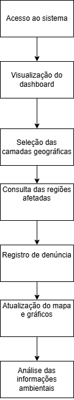
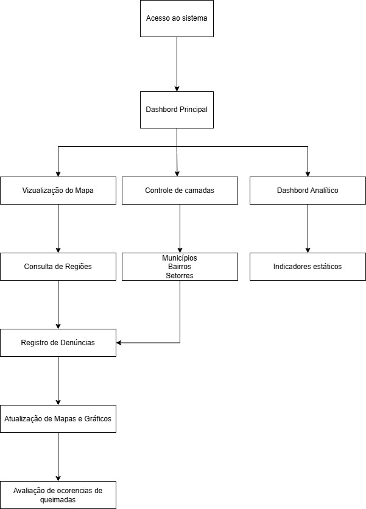
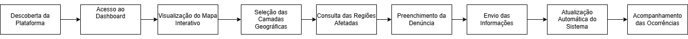
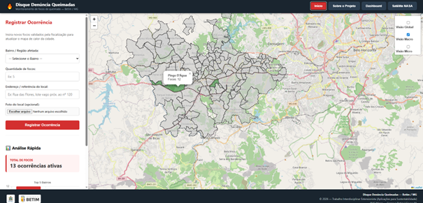
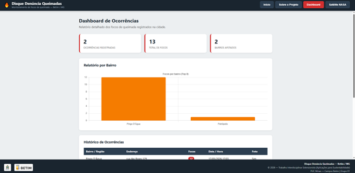
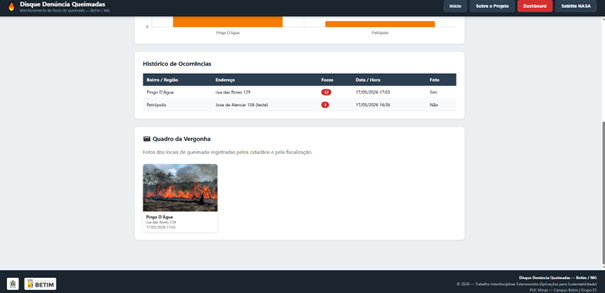

# Projeto de Interface

## Visão Geral

O sistema **Disque Denúncia Queimadas e Irregularidades** foi desenvolvido com foco na usabilidade, acessibilidade e visualização interativa das informações ambientais. A plataforma possui interface web responsiva e dinâmica, permitindo que usuários visualizem mapas, registrem denúncias e acompanhem indicadores ambientais em tempo real.

A interface foi estruturada no modelo Single Page Application (SPA), proporcionando melhor experiência de navegação sem necessidade de recarregamento constante da página. O projeto foi elaborado para atender aos requisitos funcionais relacionados ao monitoramento ambiental, registro de denúncias, visualização geográfica e análise estatística das ocorrências.

Além disso, a interface atende requisitos não funcionais como desempenho, facilidade de uso, responsividade e atualização dinâmica das informações.

---

# User Flow

O fluxo de navegação do usuário foi planejado para permitir interação simples e intuitiva dentro da plataforma.

## Fluxo principal do usuário

# Diagrama de Fluxo

O diagrama de fluxo do sistema foi desenvolvido para representar as principais interações do usuário com a plataforma **Disque Denúncia Queimadas e Irregularidades**, demonstrando o fluxo de navegação e utilização das funcionalidades disponíveis no sistema.

O fluxo foi modelado para facilitar a navegação do usuário, permitindo acesso rápido às funcionalidades de monitoramento ambiental, consulta geográfica e registro de denúncias.

---

# Fluxo Principal do Sistema

# Wireframes

Os wireframes do sistema foram desenvolvidos para representar a estrutura visual e o fluxo das principais telas da aplicação antes da implementação completa da interface. Durante essa etapa foram definidos os posicionamentos dos componentes, áreas de navegação, organização das informações e interação do usuário com o sistema.

O projeto foi desenvolvido utilizando uma metodologia ágil baseada em **Extreme Programming (XP)**, permitindo evolução contínua da interface durante o desenvolvimento. Por esse motivo, a equipe adotou uma abordagem baseada em **MVP (Minimum Viable Product)**, onde a própria aplicação funcional foi utilizada como prototipação do sistema.

Assim, em vez de criar apenas protótipos estáticos, as funcionalidades foram implementadas gradualmente em uma versão navegável e funcional da plataforma, possibilitando validação contínua da experiência do usuário e ajustes rápidos na interface.

Os wireframes e o MVP contemplam:

- Dashboard principal;
- Mapa interativo;
- Painel de camadas geográficas;
- Formulário de denúncias;
- Dashboard analítico;
- Popups informativos do mapa.

Essa abordagem permitiu:

- Melhor alinhamento entre equipe e requisitos;
- Evolução incremental da interface;
- Validação rápida das funcionalidades;
- Melhor experiência de navegação;
- Desenvolvimento contínuo da solução.

---

# Protótipo Interativo

O protótipo interativo do sistema corresponde ao próprio MVP funcional desenvolvido pela equipe. A plataforma permite navegação real entre as telas e interação completa com as funcionalidades implementadas.

O sistema possibilita:

- Navegação dinâmica sem recarregamento da página;
- Interação com mapas geográficos;
- Registro de denúncias ambientais;
- Atualização automática de gráficos e indicadores;
- Consulta das regiões afetadas em tempo real.

A utilização do MVP como protótipo interativo permitiu validar continuamente as funcionalidades planejadas durante o processo de desenvolvimento baseado em XP.

## Link do sistema/protótipo

[Disque Queimadas Plataforma Web](https://disquequeimadas.vercel.app/)

# Jornada do Usuário

A jornada do usuário do sistema **Disque Denúncia Queimadas e Irregularidades** foi desenvolvida para representar as etapas percorridas pelos usuários durante a utilização da plataforma, desde o primeiro contato com o sistema até o registro e acompanhamento das denúncias ambientais.

A análise da jornada permite identificar pontos importantes da experiência do usuário, auxiliando na melhoria da navegação, usabilidade e eficiência da aplicação.

---

# Objetivo da Jornada

O principal objetivo da jornada do usuário é demonstrar como diferentes perfis de usuários interagem com a plataforma para:

- Visualizar informações ambientais;
- Consultar regiões afetadas;
- Registrar denúncias;
- Acompanhar indicadores e mapas;
- Auxiliar no monitoramento ambiental da cidade.

---

# Mapa da Jornada do Usuário

| Fase (AIDA) | Etapa | Ações do Usuário | Pontos de Contato | Emoções e Percepções |
|---|---|---|---|---|
| Conscientização | Descoberta da plataforma | O usuário conhece o sistema através de divulgação acadêmica, ambiental ou institucional | Site da plataforma | Curiosidade e interesse inicial |
| Interesse | Acesso ao dashboard | O usuário acessa o sistema e explora o mapa interativo e gráficos | Interface web do sistema | Interesse pelas informações ambientais |
| Interesse | Navegação geográfica | O usuário interage com o mapa e seleciona camadas geográficas | Dashboard e mapa interativo | Facilidade de navegação e compreensão visual |
| Desejo | Consulta das regiões | O usuário consulta dados das regiões afetadas e indicadores ambientais | Popups do mapa e dashboard analítico | Sensação de controle e entendimento das ocorrências |
| Desejo | Registro da denúncia | O usuário preenche o formulário de denúncia ambiental | Formulário lateral da plataforma | Participação ativa e colaboração ambiental |
| Ação | Envio da denúncia | O usuário envia as informações da ocorrência | Sistema web | Satisfação pelo registro realizado |
| Ação | Atualização do sistema | O usuário visualiza o mapa e gráficos atualizados automaticamente | Dashboard em tempo real | Confiança e percepção de eficiência do sistema |

---

# Fluxo Visual da Jornada

# Interface do Sistema

O sistema **Disque Denúncia Queimadas e Irregularidades** possui uma interface web interativa desenvolvida para auxiliar no monitoramento ambiental, visualização geográfica das ocorrências e registro de denúncias relacionadas a queimadas e irregularidades ambientais no município de Betim – MG.

A aplicação foi construída no modelo **Single Page Application (SPA)**, permitindo atualização dinâmica das informações sem necessidade de recarregamento da página. Dessa forma, diversas funcionalidades e processos do sistema estão integrados dentro da mesma interface principal.

As telas foram organizadas para oferecer navegação simples, rápida e intuitiva, permitindo que o usuário visualize mapas, consulte informações ambientais e registre denúncias diretamente na plataforma.

Os processos BPMN mapeados durante a modelagem do negócio foram implementados de forma integrada na interface principal do sistema, principalmente os processos relacionados à:

- Visualização do dashboard;
- Controle de camadas geográficas;
- Consulta das regiões afetadas;
- Registro de denúncias ambientais.

---

# Observação sobre as Interfaces do Sistema

Como o sistema foi desenvolvido utilizando arquitetura SPA, muitos processos compartilham a mesma tela principal da aplicação.

Na interface principal estão integrados:

- Mapa interativo;
- Controle de camadas geográficas;
- Visualização dos bairros e setores censitários;
- Dashboard analítico;
- Formulário de denúncias;
- Popups informativos das regiões;
- Atualização dinâmica das informações.

Assim, funcionalidades como visualização do mapa, navegação geográfica e registro de denúncias acontecem dentro da mesma interface, proporcionando uma experiência mais dinâmica e centralizada ao usuário.

---

# Tela Principal do Sistema

A tela principal corresponde ao dashboard ambiental da plataforma e centraliza as principais funcionalidades do sistema.

Nela o usuário pode:

- Visualizar o mapa de calor das ocorrências;
- Navegar pelas regiões do município;
- Alternar entre bairros e setores censitários;
- Registrar denúncias;
- Acompanhar gráficos e indicadores em tempo real.

Essa interface funciona como principal ponto de interação entre o usuário e o sistema.

---

# Telas dos Processos BPMN

## Processo 1 — Visualização, Consulta Geográfica e Denúncias

Esse processo está relacionado à visualização do dashboard e consulta das informações ambientais no mapa interativo.

### Funcionalidades

- Exibição do mapa interativo;
- Visualização do mapa de calor;
- Consulta das regiões afetadas;
- Exibição de popups informativos;
- Indicadores ambientais em tempo real.
- Visualização por município;
- Visualização por bairros;
- Visualização por setores censitários;
- Alteração dinâmica das camadas geográficas.
- Formulário de denúncia;
- Descrição da ocorrência;
- Registro da localização;
- Quantidade estimada de focos;
- Atualização automática do sistema.

A funcionalidade permite identificar regiões críticas e acompanhar as ocorrências ambientais registradas.

---

# Demais Funcionalidades do Sistema

## Dashboard Analítico

O dashboard analítico apresenta gráficos e indicadores relacionados às denúncias registradas no sistema.

### Informações exibidas

- Total de ocorrências;
- Top 5 bairros mais afetados;
- Indicadores ambientais;
- Distribuição das denúncias.
- Quantidade de denúncias;
- Dados da região;
- Informações ambientais da área selecionada.

Os dados são atualizados automaticamente para auxiliar no monitoramento ambiental.

---

