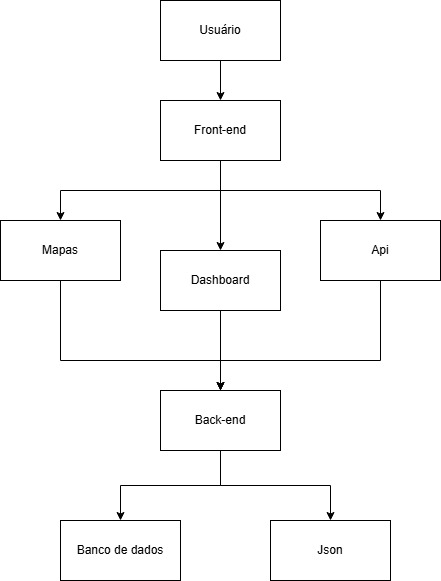
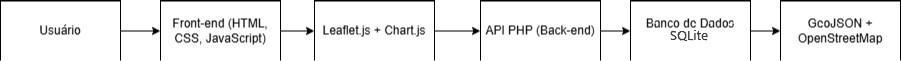
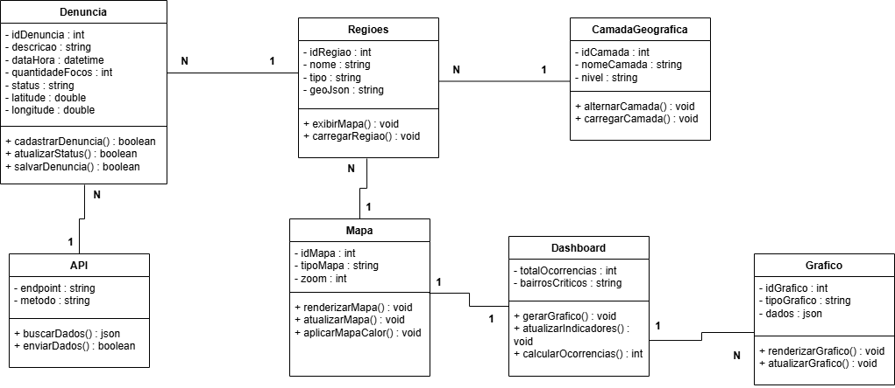
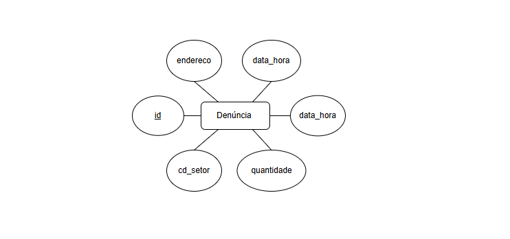
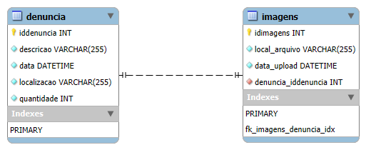
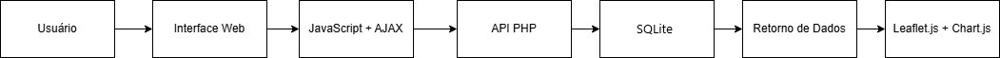

# Arquitetura da Solução

O sistema **Disque Denúncia Queimadas e Irregularidades** foi desenvolvido utilizando uma arquitetura cliente-servidor baseada em aplicação web interativa. A solução é composta por front-end, back-end, banco de dados e serviços externos responsáveis pelo funcionamento do sistema de monitoramento ambiental.

A aplicação utiliza uma estrutura baseada em **Single Page Application (SPA)**, permitindo atualização dinâmica dos dados sem recarregamento da página.

O fluxo principal do sistema funciona da seguinte forma:

1. O usuário acessa a plataforma web;
2. O front-end renderiza os mapas, gráficos e formulários;
3. As requisições são enviadas ao back-end através de APIs em PHP;
4. O back-end realiza operações no banco de dados SQLite;
5. Os dados retornam para a interface utilizando AJAX/Fetch API;
6. O mapa e os dashboards são atualizados em tempo real.

---

# Diagrama da Arquitetura da Solução



## Estrutura da Arquitetura




---

# Diagrama de Classes


---

# Modelo de Dados

O sistema utiliza banco de dados relacional para armazenar denúncias ambientais, informações geográficas e dados do dashboard analítico.

---

# Modelo Conceitual



---

# Modelo Relacional




---

# Modelo Físico

O modelo físico foi implementado utilizando SQLite.

## Script SQLite

```sql
CREATE TABLE IF NOT EXISTS ocorrencias_regiao (
    id         INTEGER PRIMARY KEY AUTOINCREMENT,
    cd_setor   TEXT    NOT NULL,                              -- código do bairro
    quantidade INTEGER DEFAULT 0,                             -- número de focos registrados
    endereco   TEXT,                                          -- endereço do local
    imagem     TEXT,                                          -- nome do arquivo da foto
    data_hora  TEXT    DEFAULT (datetime('now','localtime'))  -- data e hora do registro
);
```


---

# Tecnologias

| Dimensão | Tecnologia |
|---|---|
| Front-end | HTML5, CSS3, JavaScript |
| Bibliotecas | Leaflet.js, Chart.js |
| Back-end | PHP |
| Comunicação | AJAX / Fetch API |
| Banco de Dados | SQLite |
| Dados Geográficos | GeoJSON |
| Mapas | OpenStreetMap |
| IDE | VS Code |
| Deploy | Vercel |
| Versionamento | GitHub |

---

# Visão Operacional das Tecnologias

O sistema integra tecnologias web, geoprocessamento e banco de dados para atualização dinâmica das informações ambientais.




---

# Hospedagem

O front-end da aplicação foi hospedado na plataforma **Vercel**, permitindo deploy rápido e acesso online ao sistema.

O código-fonte foi armazenado no GitHub para controle de versão e desenvolvimento colaborativo.

Para execução local do back-end e banco de dados foram utilizados ambientes como:

- XAMPP;
- WAMP.

O sistema pode ser acessado através do link:

🔗 https://disquequeimadas.vercel.app/

O repositório do projeto está disponível em:

🔗 https://github.com/ICEI-PUC-Minas-PBE-SI-TI/2026-1-p5-tias-grupo-01-disque-denuncia-queimadas

---

# Qualidade de Software

Durante o desenvolvimento foram considerados aspectos de qualidade baseados na norma ISO/IEC 25010.

As principais características adotadas foram:

| Característica | Objetivo |
|---|---|
| Usabilidade | Facilitar utilização da plataforma |
| Confiabilidade | Garantir funcionamento correto |
| Eficiência | Atualização rápida das informações |
| Compatibilidade | Funcionamento em diferentes dispositivos |
| Manutenibilidade | Facilitar futuras melhorias |
| Portabilidade | Execução em dispositivos móveis |

As métricas utilizadas consideraram:

- Tempo de resposta;
- Responsividade;
- Facilidade de navegação;
- Atualização dinâmica do dashboard;
- Funcionamento em diferentes navegadores.
